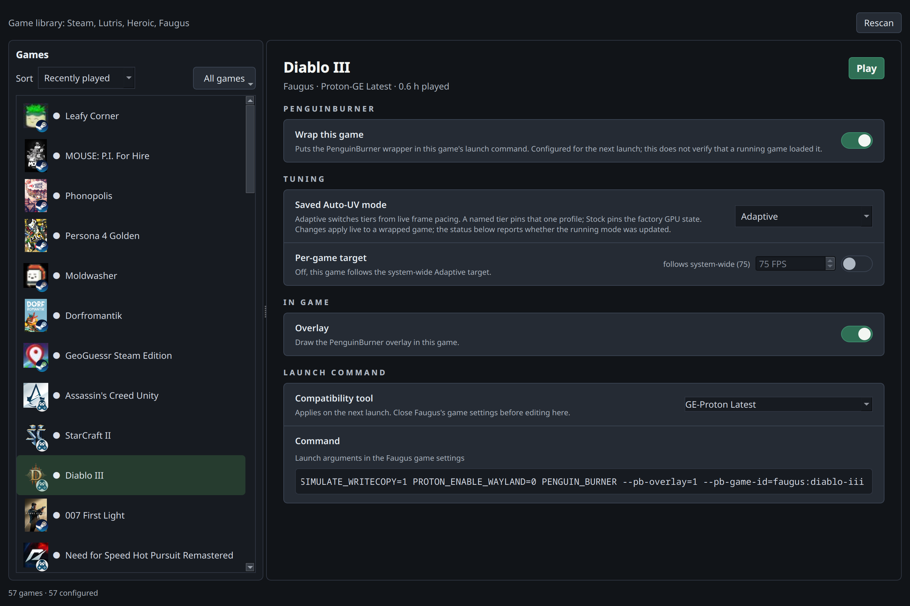

# Faugus Launcher in Game Library



Native and Flatpak installations share the same integration. When both have a
configured library, PenguinBurner prefers native while its executable is
available; otherwise it selects Flatpak. Library discovery, settings and Play
follow that choice. **Rescan** refreshes it after a launcher installation
changes.

[Game Library](game-library.md) lists your Faugus Launcher games beside Steam,
Lutris and Heroic. Enable **Wrap this game**, select a mode, and use **Play** or
launch from Faugus. Wrapper and runner changes apply on the next launch;
profile modes, Adaptive targets and overlay visibility also update live in
confirmed wrapped sessions.

See [per-game settings](game-library.md#per-game-settings) for profiles,
Adaptive targets, GPU selection, and overlay controls. Games you have hidden in
Faugus are not listed; unhide them there to configure them here.

## Proton version

Choose **Compatibility tool** to set the game's Proton runner. The list includes
Faugus's Latest channels and locally installed builds visible to the selected
native or Flatpak installation. **UMU-Proton Latest** is Faugus's empty runner
setting; it does not inherit the default used when adding new games.
Changes apply on the next launch. Close the game's settings window in Faugus
before editing here to avoid overwriting the change. Linux-native and Steam
entries do not use this selector. Use Faugus to install additional builds, then
press **Rescan**.

## Launch arguments

PenguinBurner adds its wrapper to the end of the game's **Launch arguments**,
in `games.json`, after your existing command:

```json
"launch_arguments": "PROTON_ENABLE_WAYLAND=0 gamescope -f -- PENGUIN_BURNER --pb-overlay=1 --pb-game-id=faugus:expedition-33"
```

The ID identifies the game to PenguinBurner, qualified by the launcher that
owns it. Faugus runs the whole field as one command prefix, ahead of gamemode,
MangoHud and umu-run. Your part runs first and our wrapper sits last, next to
the game, as it does in Steam: gamescope and other wrappers you add never pick
up the overlay layer themselves. Every other field of the entry, and the order
of your library, is left exactly as it was. Disabling removes our part and
restores your own arguments. A command written by an older version, with our
wrapper first, is moved into place the next time you change a wrapper setting.

The **Command** field is editable and shows that field as Faugus stores it.
Press Enter or leave the field to save. Clearing it leaves the game with no
launch arguments, which is what Faugus's own editor writes for an empty field.

## Overlay and Adaptive

Overlay and Adaptive frame telemetry require Vulkan, including DXVK and
vkd3d-proton. Selecting a Proton runner alone does not prove the overlay is
active. Known native OpenGL games keep fixed profiles and launching available
but cannot use Overlay or Adaptive.

Adaptive keeps timing markers active even with the overlay hidden. See
[latency and FPS](latency-fg.md) for the sources.

## Playing and stopping

**Play** runs `faugus-launcher --game <game id>`, so Faugus starts the game
from its own entry with the runner you chose there. Wrapped sessions are found
through the game identity and session PID carried in the process environment,
and only those sessions can be stopped from PenguinBurner.

If a game starts without the wrapper, Game Library shows **Running**, greyed
out, rather than reporting nothing. Close that game in Faugus or in the game
itself. Those sessions are recognised by the `FAUGUSID` marker Faugus puts
in front of every game it starts — the same one its own "kill this game" uses —
so they are observed even though they carry none of our identity.

## Battle.net, Ubisoft Connect, EA app and other launchers

A game entry may start a proprietary launcher first. In this case,
**PenguinBurner's wrapper and overlay environment attach to the launcher**;
the game it starts can inherit them. If the launcher stays open after the
game exits, PenguinBurner can still show **Stop** or **Running** and keep the
session's GPU profile active. **Quit the game, then fully exit the launcher
(including its tray process) to return to stopped/Play and restore the standing
profile.** Closing only the game window is insufficient.

Use a separate Faugus entry for each game, with its executable or the store
client's game-launch arguments and the correct Wine prefix. Bare known store
clients with no **Game arguments** are omitted from Game Library. Entries
with arguments are retained; PenguinBurner does not validate that those
arguments actually launch a game. **Game arguments** select what the client
runs; **Launch arguments** hold the PenguinBurner wrapper.

An already-running client may handle the request without inheriting the new
wrapper environment. Fully exit it before relaunching the wrapped entry if
the game's overlay or profile is missing. Executable-path detection can show
the game as running without proving overlay or Adaptive activity. **Stop**
controls confirmed wrapped processes only; with a wrapped client, that can
include the launcher as well as its game.

## Troubleshooting

- **Running**, greyed out: the process is visible without confirmed wrapper
  ownership; **Stop** is unavailable. Close the game and its store launcher,
  then use **Play** to relaunch with the saved settings.
- **Changes revert:** close the game's settings window in Faugus Launcher, then
  retry. Saving that window rewrites the whole library file over an external
  edit.
- **A newly added game is missing:** press **Rescan**. Faugus writes
  `games.json` when you finish adding a game.
- **A game is missing and you did not remove it:** check whether it is hidden
  in Faugus. Hidden games are left out.
- **Empty library:** check that `~/.local/share/faugus-launcher/games.json`
  exists and is readable.

PenguinBurner stores per-game preferences in
`~/.config/PenguinBurner/faugus-game-settings.json`. Faugus's own library is
`~/.local/share/faugus-launcher/games.json`, or
`~/.var/app/io.github.Faugus.faugus-launcher/data/faugus-launcher/games.json`
for the Flatpak build.
